# 24-Hour Temperature Forecasting with LSTM Networks

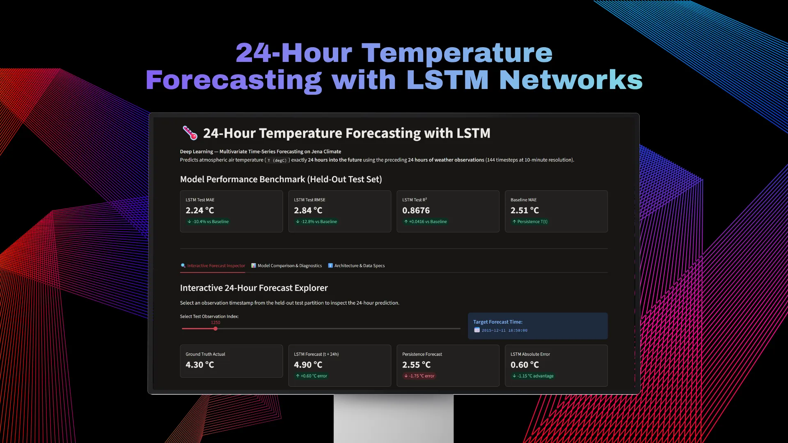


## Project Overview

**24-Hour Temperature Forecasting with LSTM Networks** is an end-to-end multivariate time-series forecasting system built in PyTorch to predict ambient dry-bulb air temperature (`T (degC)`) exactly 24 hours ahead ($t + 144$ steps at 10-minute resolution) from the preceding 24 hours of surface meteorological observations. Trained and evaluated across 8 years of continuous weather station telemetry from the Max Planck Institute for Biogeochemistry in Jena, Germany, the pipeline enforces strict chronological splitting, physical timeline segmentation across sensor outages, leakage-safe preprocessing, and empirical benchmarking against a 24-hour persistence baseline, paired with an interactive Streamlit diagnostic dashboard.

## Problem Statement & Objectives

Accurate 24-hour-ahead ambient air temperature forecasting supports power grid load dispatch, district heating management, agricultural frost mitigation, and renewable generation planning. Because atmospheric thermodynamics are non-linear and governed by coupled moisture, pressure, density, and wind dynamics, univariate extrapolation struggles during advancing cold or warm fronts.

- Formulate 24-hour-ahead temperature prediction as a supervised multivariate sequence-to-scalar regression task over a 144-step (24-hour) lookback window and 144-step forecast horizon.
- Eliminate temporal and statistical data leakage through exact deduplication, `-9999` wind-speed sentinel remediation, continuous timeline segmentation across multi-hour sensor outages, and training-only imputer/scaler fitting.
- Capture multi-scale diurnal, synoptic, and seasonal dynamics using a 2-layer stacked PyTorch LSTM regressor with 19 meteorological and cyclical features.
- Benchmark held-out test performance against the competitive 24-hour persistence baseline ($T_{t+24\text{h}} = T_t$) using MAE, RMSE, $R^2$, residual diagnostics, and seasonal/temperature-regime breakdowns.
- Deliver reproducible training/evaluation scripts alongside an interactive Streamlit web dashboard for inspecting test predictions and diagnostic visualizations.

## Data & Input Sources

The project uses the Jena Climate 2009–2016 observational time-series recorded every 10 minutes at the Max Planck Institute for Biogeochemistry weather station in Jena, Germany, stored locally as a CSV file and accompanied by generated training logs and test prediction exports.

| Attribute | Description |
| :--- | :--- |
| **Dataset / Input Source** | Jena Climate Meteorological Time Series (`jena_climate_2009_2016.csv`) |
| **Source** | [dataset/original/jena_climate_2009_2016.csv](dataset/original/jena_climate_2009_2016.csv) |
| **Format** | CSV (420,551 raw rows × 15 columns; 10-minute cadence, 2009-01-01 to 2017-01-01) |
| **Samples / Records** | 420,224 deduplicated records across 3 continuous segments; 69,897 windowed sequences (49,042 Train / 10,456 Val / 10,399 Test at stride 6) |
| **Features / Input Shape** | `(batch_size, 144, 19)` — 13 raw meteorological channels + 6 circular/cyclical encodings |
| **Target / Label** | Scalar ambient air temperature `T (degC)` at $t + 144$ timesteps (24 hours ahead) |

### Data Preprocessing & Feature Engineering

Real-world meteorological telemetry contains duplicate logs, `-9999.0` wind-speed sensor fault sentinels, and communication outages; therefore, [src/data_preprocessing.py](src/data_preprocessing.py) implements a deterministic, leakage-safe curation and feature engineering pipeline prior to sequence windowing.

| Stage / Transformation | Input | Output |
| :--- | :--- | :--- |
| **Deduplication & Sorting** | 420,551 raw CSV rows | 420,224 unique, chronologically ordered records (327 exact duplicates removed) |
| **Sentinel Remediation** | `wv (m/s)` (18) and `max. wv (m/s)` (20) `-9999.0` flags | Replaced with `NaN` for training-fitted median imputation |
| **Causal Grid & Gap Splitting** | Irregular timeline (544 missing steps on 420,768-step grid) | Causal `ffill(limit=2)` for $\le 30\text{ min}$ gaps; 3 continuous segments across 16h and 3.1d outages |
| **Circular & Cyclical Encoding** | `wd (deg)` and `Date Time` | `wd_sin`, `wd_cos`, `day_sin`, `day_cos` (86,400s), `year_sin`, `year_cos` (365.25d) |
| **Leakage-Safe Imputation & Scaling** | 19 features and target `T (degC)` | `SimpleImputer(strategy='median')` and `StandardScaler` fit strictly on rows `< train_end_dt` |

1. Load raw CSV records, drop 327 exact duplicate rows, parse `Date Time` (`%d.%m.%Y %H:%M:%S`), and sort chronologically.
2. Convert `-9999.0` wind-speed sentinel values in `wv (m/s)` and `max. wv (m/s)` to `NaN`.
3. Compute circular wind components (`wd_sin`, `wd_cos`) and cyclical diurnal/annual encodings (`day_sin`, `day_cos`, `year_sin`, `year_cos`).
4. Reindex onto an exact 10-minute grid, apply causal forward fill (`limit=2` steps = 20 minutes) for short gaps, and split across long outages into 3 continuous segments (301,352 / 109,596 / 9,284 steps).
5. Fit `SimpleImputer(strategy='median')` and `StandardScaler` exclusively on training observations ($< \text{2014-08-08 09:39:00}$), transform all segments, and serialize the preprocessing bundle to [models/preprocessing_objects.joblib](models/preprocessing_objects.joblib).

## Tech Stack

| Category | Technology | Purpose |
| :--- | :--- | :--- |
| **Programming Language** | Python | Core pipeline, preprocessing, training, evaluation, and dashboard runtime |
| **Deep Learning Framework** | PyTorch | `LSTMRegressor` architecture, MSE optimization, gradient clipping, and checkpointing |
| **Data Processing** | Pandas, NumPy | Time-grid reindexing, deduplication, segment partitioning, and tensor windowing |
| **Classical ML & Metrics** | Scikit-Learn, SciPy | `SimpleImputer`, `StandardScaler`, MAE/RMSE/$R^2$ metrics, and statistical utilities |
| **Visualization** | Matplotlib, Seaborn | 11 diagnostic figures (chronology, KDEs, correlation heatmap, residuals, benchmarks) |
| **Artifact Serialization** | Joblib | Persistence of fitted imputers, scalers, and split timestamps |
| **Interactive UI** | Streamlit | Interactive test sequence explorer, KPI scorecard, and diagnostic figure viewer |

## Machine Learning Approach

The forecasting problem is formulated as supervised deep sequence-to-scalar regression over continuous multivariate meteorological windows, avoiding cross-outage sequence corruption and future data leakage.

| Attribute | Value |
| :--- | :--- |
| **Learning Paradigm** | Deep Learning |
| **Problem Domain** | Atmospheric Meteorology & Multivariate Time-Series Forecasting |
| **ML Task** | 24-Hour-Ahead Ambient Air Temperature Regression |
| **Input Representation** | 144-step (24-hour) multivariate tensor across 19 standardized channels |
| **Target / Output** | Unscaled scalar temperature prediction `T (degC)` at $t + 144$ (via inverse-scaled readout) |
| **Comparison Baseline** | 24-hour Persistence Baseline ($\hat{T}_{\text{persistence}}(t + 24\text{h}) = T(t)$) |

## Model Overview

The primary predictor is `LSTMRegressor` defined in [src/model.py](src/model.py), a 2-layer stacked recurrent neural network with 57,153 trainable parameters trained from scratch on the Jena Climate training partition.

| Attribute | Specification |
| :--- | :--- |
| **Model Name** | Stacked LSTM Regressor (2-Layer) |
| **Architecture** | `nn.LSTM(19, 64, num_layers=2, dropout=0.2)` → last timestep `h_144` → `Linear(64, 32)` → `ReLU` → `Dropout(0.1)` → `Linear(32, 1)` |
| **Model Type** | Recurrent Neural Network (Long Short-Term Memory) |
| **Framework** | PyTorch |
| **Trainable Parameters** | 57,153 |
| **Input Tensor Shape** | `(batch_size, 144, 19)` |
| **Output Tensor Shape** | `(batch_size, 1)` |
| **Pretrained Status** | Trained from scratch on Jena Climate (2009–2014 training split) |

## ML Workflow

1. **Data Ingestion & Sanitization**: [src/data_preprocessing.py](src/data_preprocessing.py) cleans the raw CSV ([dataset/original/jena_climate_2009_2016.csv](dataset/original/jena_climate_2009_2016.csv)), eliminates duplicates and `-9999` sentinels, engineers circular/cyclical features, and partitions the timeline into 3 outage-free segments.
2. **Leakage-Safe Scaling & Serialization**: Training-only `SimpleImputer` and `StandardScaler` instances transform all segments and save to [models/preprocessing_objects.joblib](models/preprocessing_objects.joblib).
3. **Lazy Sequence Windowing**: `JenaClimateSequenceDataset` in [src/dataset.py](src/dataset.py) constructs `(144, 19)` input windows with origin stride `6` (1 hour) and assigns samples strictly by target timestamp $t + 144$ into Train (70%), Validation (15%), and Test (15%) `DataLoader` splits.
4. **Model Training & Checkpointing**: [src/train.py](src/train.py) trains `LSTMRegressor` ([src/model.py](src/model.py)) with MSE loss, Adam optimizer, `ReduceLROnPlateau`, gradient norm clipping (`5.0`), and early stopping (`patience=5`), saving the best checkpoint to [models/best_lstm_model.pt](models/best_lstm_model.pt) and epoch metrics to [dataset/training_history.csv](dataset/training_history.csv).
5. **Held-Out Evaluation & Diagnostics**: [src/evaluate.py](src/evaluate.py) inverse-transforms test predictions to Celsius, compares LSTM against the 24-hour persistence baseline, exports [metrics.json](metrics.json) and [dataset/test_predictions.csv](dataset/test_predictions.csv), and renders 11 diagnostic figures in `figures/`.
6. **Interactive Exploration**: [streamlit/app.py](streamlit/app.py) loads the trained checkpoint, preprocessing bundle, metrics, and predictions for interactive inspection across test timestamps (further documented in [final_report.md](final_report.md)).

## ML Pipeline Architecture

The diagram below traces the implemented data curation, sequence windowing, model training, evaluation, and interactive inspection components verified in `src/` and `streamlit/`.

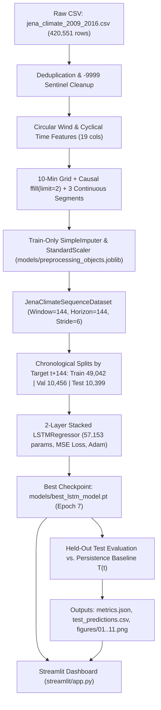

## Model Training & Configuration

Training was executed from scratch in [src/train.py](src/train.py) on CPU using 8 PyTorch execution threads, running for 12 epochs (403.5 seconds total) before early stopping restored the Epoch 7 best validation checkpoint (`Val MSE = 0.110885`, `Train MSE = 0.113502`).

| Parameter | Verified Value | Purpose / Behavior |
| :--- | :--- | :--- |
| **Input Window / Horizon / Stride** | `144` / `144` / `6` | 24h lookback, 24h ahead target, 1h stride between forecast origins |
| **Hidden Size / Layers / FC Head** | `64` / `2` / `32` | Stacked LSTM recurrent core feeding `Linear(64, 32) -> ReLU -> Dropout(0.1) -> Linear(32, 1)` |
| **Inter-Layer Dropout** | `0.2` | Regularization between LSTM layer 1 and layer 2 |
| **Loss Criterion** | `nn.MSELoss()` | Mean Squared Error computed on standardized target temperature |
| **Optimizer & Weight Decay** | `Adam` (`lr=1e-3`, `weight_decay=1e-5`) | Adaptive gradient optimization with mild L2 regularization |
| **LR Scheduler** | `ReduceLROnPlateau` (`factor=0.5`, `patience=2`, `min_lr=1e-5`) | Halved learning rate to `0.0005` at Epoch 6 and `0.00025` at Epoch 11 |
| **Gradient Clipping** | `max_norm=5.0` | Prevents exploding gradients during backpropagation through 144 steps |
| **Batch Size / Max Epochs / Patience** | `128` / `20` / `5` | Early stopping triggered after Epoch 12; best checkpoint saved at Epoch 7 |
| **Random Seed** | `42` | Fixed across Python `random`, NumPy, and PyTorch |

```python
model = LSTMRegressor(
    input_size=19,
    hidden_size=64,
    num_layers=2,
    dropout=0.2,
    fc_hidden_size=32,
)
criterion = nn.MSELoss()
optimizer = Adam(model.parameters(), lr=1e-3, weight_decay=1e-5)
scheduler = ReduceLROnPlateau(optimizer, mode="min", factor=0.5, patience=2, min_lr=1e-5)
```

### Model Comparison & Selection

Because ambient temperature exhibits a strong 24-hour diurnal cycle, [src/evaluate.py](src/evaluate.py) directly benchmarks the 2-layer stacked LSTM against the 24-hour persistence baseline ($\hat{T}(t + 24\text{h}) = T(t)$) across the identical 10,399 held-out test timestamps (Oct 2015 – Dec 2016).

| Model | Test MAE (°C) | Test RMSE (°C) | Test $R^2$ | Relative Advantage |
| :--- | :---: | :---: | :---: | :--- |
| **24-Hour Persistence Baseline** | 2.5066 | 3.2586 | 0.8261 | Reference diurnal benchmark |
| **Stacked LSTM Regressor (2-Layer)** | **2.2449** | **2.8428** | **0.8676** | **-10.44% MAE / -12.76% RMSE / +0.0416 $R^2$** |

### Model Artifacts & Checkpoints

All serialized weights, preprocessing transformers, and evaluation outputs generated by the project pipeline are stored directly in the repository.

| Artifact | Format | Purpose | Location |
| :--- | :---: | :--- | :--- |
| **Best LSTM Checkpoint** | `.pt` | Epoch 7 `model_state_dict`, `optimizer_state_dict`, losses, and architecture config | [models/best_lstm_model.pt](models/best_lstm_model.pt) |
| **Preprocessing Bundle** | `.joblib` | Training-fitted `SimpleImputer`, `feature_scaler`, `target_scaler`, and split timestamps | [models/preprocessing_objects.joblib](models/preprocessing_objects.joblib) |
| **Evaluation Metrics** | `.json` | Held-out test metrics for LSTM vs. persistence baseline and training summary | [metrics.json](metrics.json) |
| **Training History Log** | `.csv` | Per-epoch train/validation MSE, learning rate, and duration across Epochs 1–12 | [dataset/training_history.csv](dataset/training_history.csv) |
| **Test Predictions Log** | `.csv` | Timestamp-aligned actuals, LSTM forecasts, persistence forecasts, and residuals (10,399 rows) | [dataset/test_predictions.csv](dataset/test_predictions.csv) |

## Model Evaluation & Results

On the held-out test partition (10,399 samples spanning `2015-10-20 16:50:00` to `2016-12-31 23:40:00`), predictions were inverse-transformed back to degrees Celsius and evaluated separately from the validation split (`Val MSE = 0.1109` at Epoch 7).

| Metric | Persistence Baseline ($T_t$) | LSTM Model | Improvement / Notes |
| :--- | :---: | :---: | :--- |
| **Test MAE (°C)** | 2.5066 | **2.2449** | **10.44% error reduction** (-0.2617 °C) |
| **Test RMSE (°C)** | 3.2586 | **2.8428** | **12.76% error reduction** (-0.4158 °C) |
| **Test $R^2$ Score** | 0.8261 | **0.8676** | **+0.0416** explained variance gain |
| **Best Validation MSE (Scaled)** | — | **0.1109** | Achieved at Epoch 7 (`Train MSE = 0.1135`) |

- **Diurnal & Synoptic Tracking**: Multivariate inputs (`p (mbar)`, `VPdef`, `Tdew`, `rh`, `rho`, wind vectors) allow the LSTM to anticipate frontal warming and cooling trends where 24-hour persistence lags.
- **Residual Distribution**: Test residuals remain stationary over the 14-month test period with tighter dispersion (residual std `2.84 °C`, mean `-0.16 °C` vs. persistence std `3.26 °C`).
- **Known Limitations**: As a single-station model in Jena, Germany, prediction error rises during autumn/winter frontal transitions and freezing conditions (`< 0 °C`) where upwind synoptic radar/NWP fields and snow-albedo feedbacks are unavailable.

## Results Visualization & Preview

### 1. Streamlit Dashboard Benchmark KPIs & Forecast Explorer
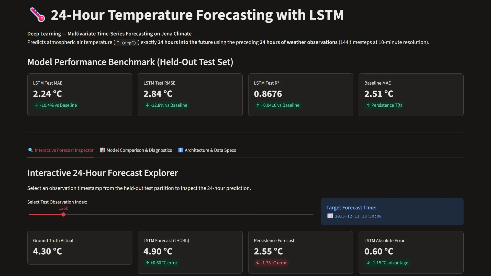
The primary Streamlit dashboard view displays the held-out test benchmark scorecard (`2.24 °C` MAE, `2.84 °C` RMSE, `0.8676` $R^2$, and `2.51 °C` baseline MAE) alongside the Interactive 24-Hour Forecast Explorer. For sample index `1250` (`2015-12-11 18:50:00`), the LSTM predicts `4.90 °C` against a `4.30 °C` ground truth (`0.60 °C` absolute error), outperforming the persistence forecast (`2.55 °C`) by `1.15 °C`.

### 2. Local 24-Hour Forecast Trajectory Comparison
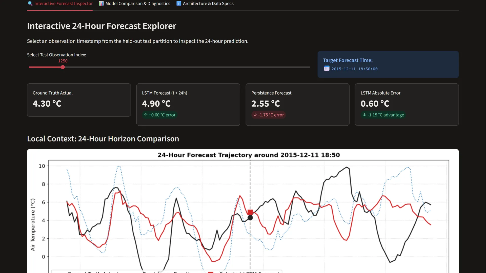
The interactive trajectory view plots a 24-hour local context window around `2015-12-11 18:50`, comparing ground truth ambient temperature (solid black), the 24-hour LSTM forecast (solid red), and the persistence baseline (dotted blue). The LSTM tracks diurnal transitions closely while damping the phase-lag errors visible in the persistence trace.

### 3. Model Architecture, Sequence & Feature Specifications
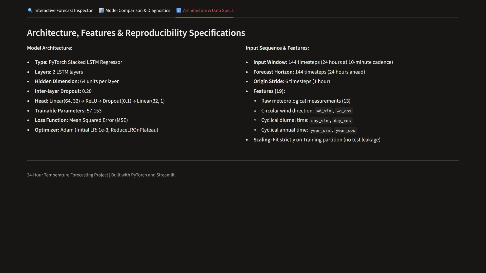
The specifications tab summarizes the 2-layer stacked PyTorch LSTM (`64` hidden units, `0.20` inter-layer dropout, `57,153` trainable parameters, `MSE` loss, `Adam` optimizer with `ReduceLROnPlateau`) and the 19-channel input configuration (`144`-step lookback, `144`-step horizon, `6`-step stride, circular wind and cyclical temporal encodings).

### 4. Partition Temperature Distributions, Residual KDE & 1:1 Scatter Grid
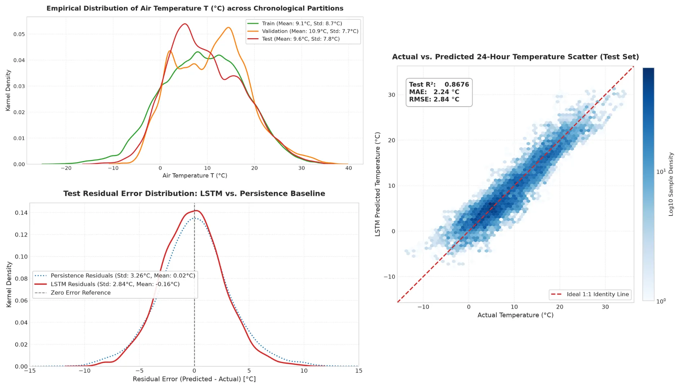
This 3-panel diagnostic grid confirms distributional consistency across Train (`9.1 °C` mean), Validation (`10.9 °C` mean), and Test (`9.6 °C` mean) partitions, shows narrower LSTM residual density (`2.84 °C` std vs. `3.26 °C` persistence std), and demonstrates tight clustering along the 1:1 identity line across `-15 °C` to `+35 °C` (`Test R² = 0.8676`).

### 5. Eight-Year Temperature Chronology & Chronological Test Residuals
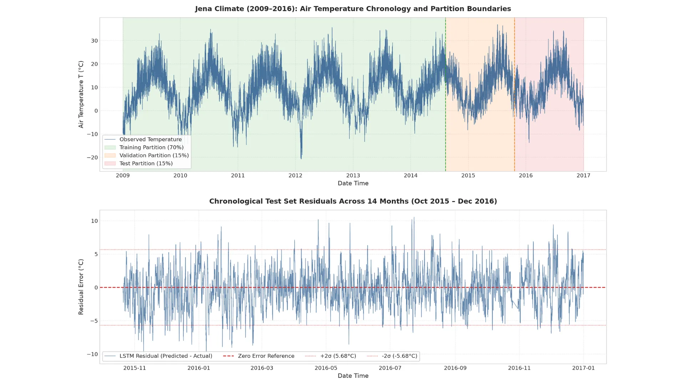
The upper panel plots the 2009–2016 Jena temperature chronology across the 70% training, 15% validation, and 15% test partitions, confirming clear annual seasonality. The lower panel tracks test residuals over 14 months (Oct 2015 – Dec 2016) within `±2σ` bounds (`±5.68 °C`), verifying stationary error behavior without temporal drift.

### 6. Full Held-Out Test Tracking & July 2016 Zoomed Diurnal View
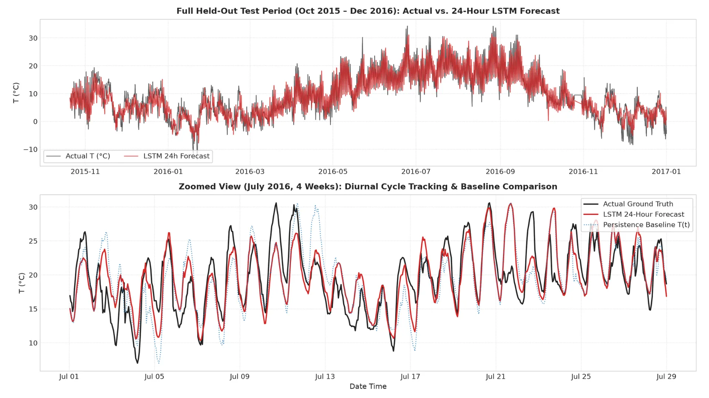
The top panel shows continuous LSTM tracking across the entire Oct 2015 – Dec 2016 held-out test span, while the bottom 4-week zoom (July 2016) highlights how the LSTM reproduces daily heating/cooling amplitudes and anticipates multi-day weather shifts more accurately than the dotted persistence baseline.

### 7. Seasonal Monthly MAE & Temperature Regime Error Breakdown
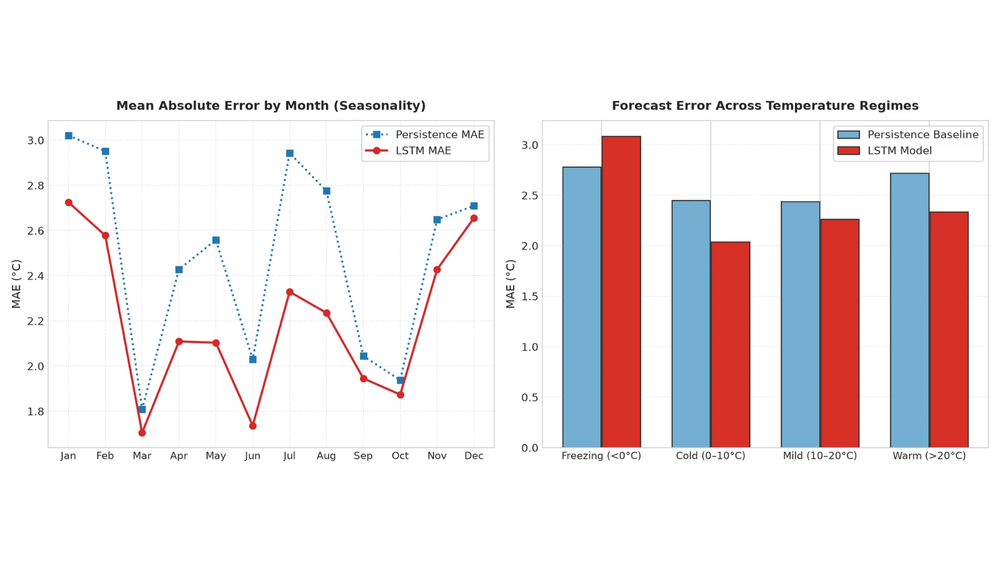
Monthly diagnostics (left) show that the LSTM consistently achieves lower MAE than persistence across all 12 calendar months, reaching minimum errors (`~1.7–2.1 °C`) in spring/summer. The regime breakdown (right) shows clear LSTM gains across `Cold (0–10 °C)`, `Mild (10–20 °C)`, and `Warm (>20 °C)` bins, while `Freezing (<0 °C)` exhibits higher error (`~3.08 °C` vs. `~2.78 °C` persistence) due to sub-zero radiative inversions and snow-cover non-linearities.

### 8. Performance Benchmark & Data Quality Remediation Summary
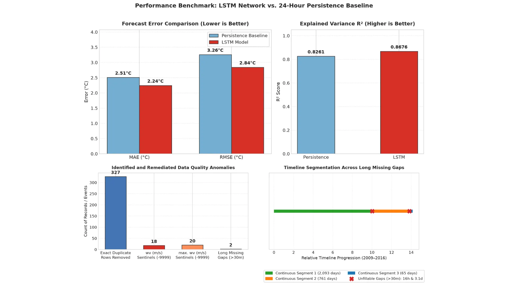
The top benchmark panels visually summarize the LSTM's reductions in MAE (`2.24 °C` vs. `2.51 °C`), RMSE (`2.84 °C` vs. `3.26 °C`), and gain in $R^2$ (`0.8676` vs. `0.8261`). The bottom panels document the `327` removed duplicate rows, `38` `-9999` wind-speed sentinels (`18` `wv`, `20` `max. wv`), and the resulting 3 continuous timeline segments (`2,093`, `761`, and `65` days) split across the `16h` and `3.1d` station outages.

### 9. LSTM Training & Validation Loss Convergence Curve
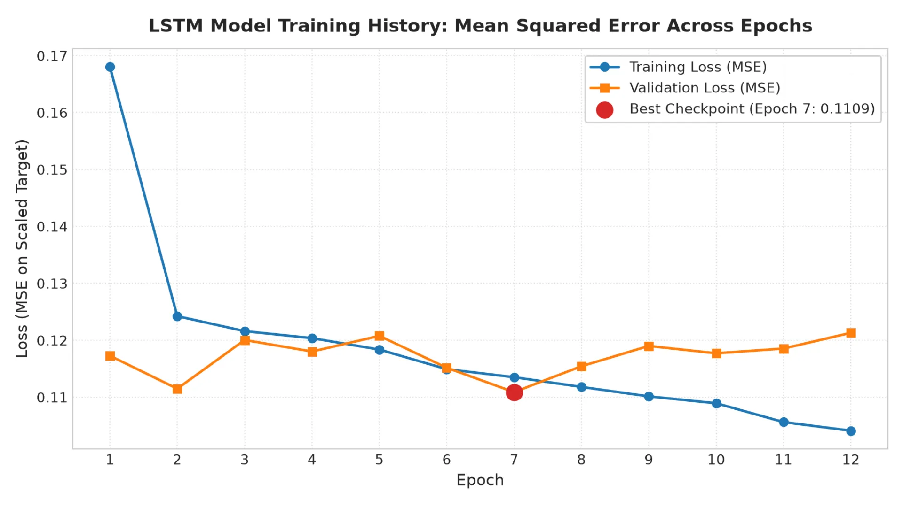
Training and validation MSE curves across Epochs 1–12 show rapid initial convergence from `0.1680` to `0.1242` train MSE by Epoch 2, with the optimal generalization checkpoint achieved at Epoch 7 (`Val MSE = 0.1109`) before learning-rate reductions (`0.0005` → `0.00025`) and early stopping prevented overfitting.

### 10. Engineered Feature Correlation Heatmap
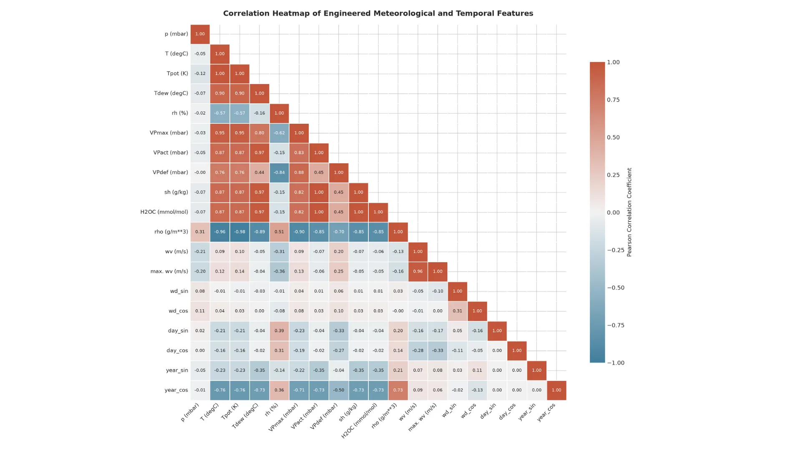
The lower-triangular Pearson correlation matrix over all 19 input channels reveals strong physical couplings with `T (degC)`: near-collinear potential temperature `Tpot (K)` (`1.00`), saturation vapor pressure `VPmax` (`0.95`), dew point `Tdew` (`0.90`), inverse ideal-gas air density `rho` (`-0.96`), and annual seasonality `year_cos` (`-0.76`).

## Prerequisites

- **Operating System**: Windows, Linux, or macOS (developed and benchmarked on Windows x64)
- **Python**: Python 3.10+ recommended (recorded experiment environment used Python 3.15.1)
- **Hardware**: Multi-core CPU (CPU execution is fully supported; training took ~6.72 minutes on an 8-thread CPU; CUDA GPU optional)
- **Core Packages**: `torch>=2.0.0`, `numpy>=1.24.0`, `pandas>=2.0.0`, `scipy>=1.10.0`, `scikit-learn>=1.3.0`, `matplotlib>=3.7.0`, `seaborn>=0.12.0`, `joblib>=1.3.0`, `streamlit>=1.30.0` (listed in [requirements.txt](requirements.txt))
- **Dataset**: [dataset/original/jena_climate_2009_2016.csv](dataset/original/jena_climate_2009_2016.csv) (already included in the repository)

## Installation & Setup

1. Clone the repository and navigate into the project directory:
   ```bash
   git clone https://github.com/weztcy/24-Hour-Temperature-Forecasting-with-LSTM-Networks.git
   cd "24-Hour Temperature Forecasting with LSTM Networks"
   ```
2. Create and activate a Python virtual environment:
   ```bash
   python -m venv .venv
   # Windows PowerShell:
   .venv\Scripts\Activate.ps1
   # Linux/macOS:
   source .venv/bin/activate
   ```
3. Install all required dependencies from [requirements.txt](requirements.txt):
   ```bash
   pip install -r requirements.txt
   ```

## Usage & Execution

Once dependencies are installed, you can launch the interactive Streamlit dashboard immediately using the pre-saved artifacts, or execute the pipeline modules from the repository root (note that the raw CSV resides at `dataset/original/jena_climate_2009_2016.csv`).

1. Launch the interactive Streamlit forecast dashboard from the repository root (referencing `models/` and `outputs/`):
   ```bash
   streamlit run streamlit/app.py
   ```
2. Note on paths when running standalone scripts: `src/train.py`, `src/data_preprocessing.py`, and `src/evaluate.py` default `csv_path` to `"dataset/jena_climate_2009_2016.csv"` and `outputs_dir` to `"outputs"`, whereas this repository stores the CSV at `dataset/original/jena_climate_2009_2016.csv` and precomputed outputs at `dataset/` and `metrics.json`. Pass explicit paths in Python to run directly against the repository layout:
   ```bash
   python -c "from src.evaluate import run_evaluation; run_evaluation(csv_path='dataset/original/jena_climate_2009_2016.csv', outputs_dir='outputs', figures_dir='outputs/figures')"
   ```

## Reproducibility & Execution

Model training and held-out evaluation are designed for deterministic execution on CPU with fixed random seeds and strict temporal split boundaries.

1. **Random Seeds & Threading**: `set_seed(42)` in [src/train.py](src/train.py) fixes `random`, `numpy`, and `torch` seeds (`cudnn.deterministic = True` when CUDA is used) and configures `torch.set_num_threads(min(8, os.cpu_count() or 4))`.
2. **Chronological Split Integrity**: Partitions are fixed at 70% Train (`< 2014-08-08 09:39:00`), 15% Validation (`2014-08-08 09:39:00` to `2015-10-20 16:49:30`), and 15% Test (`>= 2015-10-20 16:49:30`) based on target timestamp $t + 144$.
3. **End-to-End Reproduction Command**:
   ```bash
   python -c "from src.train import train_lstm_pipeline; from src.evaluate import run_evaluation; train_lstm_pipeline(csv_path='dataset/original/jena_climate_2009_2016.csv', outputs_dir='outputs'); run_evaluation(csv_path='dataset/original/jena_climate_2009_2016.csv', outputs_dir='outputs', figures_dir='outputs/figures')"
   ```
4. **Nondeterminism Note**: Exact floating-point timing and minor CPU kernel rounding can vary slightly across hardware/OS versions, though Epoch 7 convergence (`Val MSE ~0.1109`) and held-out Celsius metrics (`MAE 2.24 °C`, `RMSE 2.84 °C`, `R² 0.8676`) are captured in [metrics.json](metrics.json) and [dataset/training_history.csv](dataset/training_history.csv).

## Contributing

Contributions are welcome for improving feature engineering, benchmarking alternative sequence architectures, or expanding diagnostic tooling.

1. Fork the repository.
2. Create a branch for the change (`git checkout -b feature/your-feature`).
3. Make the changes while preserving leakage-safe chronological splitting and segment isolation.
4. Run relevant checks or evaluation scripts to verify predictions and figures.
5. Commit and push the branch.
6. Open a pull request with a clear explanation.

## License

This project is licensed under the MIT License.
See the [LICENSE](LICENSE) file for details.

## Author & Contact

**Yohanes Dimas Pratama**

- GitHub: [github.com/weztcy](https://github.com/weztcy)
- Portfolio: [yohanesdimas.com](https://yohanesdimas.com)
- LinkedIn: [linkedin.com/in/yohanes-dimas](https://www.linkedin.com/in/yohanes-dimas)
