# 24-Hour Temperature Forecasting with LSTM Networks: An End-to-End Deep Learning Study

**Author:** AI Engineering & Deep Learning Research Agent  
**Date:** November 22, 2026  
**Project Category:** Deep Learning — Multivariate Time-Series Forecasting  
**Repository:** `c:\Users\Dimas\Videos\24-Hour Temperature Forecasting with LSTM Networks`  

---

## 1. Project Title
**24-Hour Ahead Ambient Air Temperature Forecasting Using Deep Long Short-Term Memory (LSTM) Networks on High-Cadence Meteorological Observations**

---

## 2. Executive Summary

Accurate short-term atmospheric temperature forecasting 24 hours in advance is essential for municipal power grid management, district heating load planning, agricultural frost risk warning, and transportation logistics. This project develops, trains, evaluates, and documents an end-to-end, production-grade deep learning pipeline using a **multivariate Long Short-Term Memory (LSTM) recurrent neural network** to forecast air temperature (`T (degC)`) 24 hours into the future ($t + 144$ timesteps at 10-minute sampling cadence) based solely on the preceding 24 hours of local meteorological observations ($t - 143$ to $t$).

The pipeline is benchmarked against the standard **24-hour persistence baseline** ($T_{t+24\text{h}} = T_t$), which serves as a competitive domain benchmark due to the pronounced diurnal temperature cycle. The model was trained and evaluated on 8 years (2009–2016) of 10-minute meteorological measurements recorded by the Max Planck Institute for Biogeochemistry in Jena, Germany.

### Key Headline Test Results (Held-Out Test Set: 10,399 Samples, Oct 2015 – Dec 2016)
- **LSTM Test MAE:** **2.2449 °C** (vs. **2.5066 °C** for Persistence) — **10.44% error reduction**.
- **LSTM Test RMSE:** **2.8428 °C** (vs. **3.2586 °C** for Persistence) — **12.76% error reduction**.
- **LSTM Explained Variance ($R^2$):** **0.8676** (vs. **0.8261** for Persistence) — **+5.03% increase in explained variance**.
- **Pipeline Integrity:** Strict chronological time-series splitting (70% train, 15% validation, 15% test), zero future data leakage, physical timeline segmentation across sensor outages, and causal feature scaling fitted strictly on training data.

---

## 3. Introduction

### 3.1 Practical Utility of 24-Hour Temperature Forecasting
Air temperature is one of the primary atmospheric variables affecting human society, energy infrastructure, and ecosystems. A reliable 24-hour ahead temperature forecast allows:
1. **Energy Grid & Heating Optimization:** Electricity and gas consumption for domestic and commercial climate control (HVAC and district heating) correlates strongly with ambient temperature. Accurate next-day forecasts prevent peak-load plant over-generation and optimize energy dispatch.
2. **Agricultural Protection:** Sudden nocturnal temperature drops below 0 °C can destroy vineyards, orchards, and sensitive crops. 24 hours of lead time enables farmers to deploy frost-protection measures (smudge pots, sprinkler irrigation, giant wind machines).
3. **Renewable Energy Integration:** Ambient temperature affects wind turbine air density drag, solar panel photovoltaic efficiency, and transmission line thermal capacity ratings.

### 3.2 Why Multivariate Time-Series Forecasting and LSTM?
Atmospheric dynamics are non-linear, chaotic, and governed by coupled physical interactions between thermodynamics, atmospheric moisture, air density, wind velocity, and solar radiation. 

Traditional univariate autoregressive models (e.g., ARIMA) rely solely on historical temperature sequences and struggle to anticipate sudden air-mass advections (cold fronts, warm fronts). In contrast:
- **Multivariate Input Synergy:** By coupling temperature observations with atmospheric pressure (`p`), vapor pressure deficit (`VPdef`), dew point (`Tdew`), relative humidity (`rh`), air density (`rho`), and wind vectors (`wv`, `wd`), the model can detect advancing air masses hours before the temperature changes at the surface station.
- **Recurrent Memory via LSTM:** LSTMs possess internal gated memory cells ($c_t$) controlled by input ($i_t$), forget ($f_t$), and output ($o_t$) gates. This architecture captures multi-scale temporal dependencies: rapid hourly fluctuations, 24-hour diurnal oscillations, and multi-day synoptic weather systems without suffering from vanishing gradients.

---

## 4. Dataset Description

The project utilizes the benchmark meteorological dataset recorded at the weather station of the Max Planck Institute for Biogeochemistry in Jena, Germany:
- **Supplied Filename:** `dataset/jena_climate_2009_2016.csv`
- **Temporal Coverage:** January 1, 2009 00:10:00 to January 1, 2017 00:00:00 (8 full calendar years).
- **Sampling Frequency:** Exactly every 10 minutes (6 readings per hour, 144 readings per day).
- **Raw Observations:** 420,551 rows × 15 columns.
- **Target Variable:** Ambient Air Temperature `T (degC)`.

### Summary of Observed Meteorological Variables
| Variable Name | Unit | Physical Description | Observed Range (Min / Max) |
| :--- | :---: | :--- | :---: |
| `p (mbar)` | mbar | Atmospheric surface air pressure | 913.60 to 1015.35 |
| `T (degC)` *(Target)* | °C | Ambient dry-bulb air temperature | -23.01 to 37.28 |
| `Tpot (K)` | K | Potential temperature referenced to 1000 mbar | 250.60 to 311.34 |
| `Tdew (degC)` | °C | Dew point temperature | -25.01 to 23.11 |
| `rh (%)` | % | Relative humidity | 12.95 to 100.00 |
| `VPmax (mbar)` | mbar | Saturation vapor pressure | 0.95 to 63.77 |
| `VPact (mbar)` | mbar | Actual vapor pressure | 0.79 to 28.32 |
| `VPdef (mbar)` | mbar | Vapor pressure deficit | 0.00 to 46.01 |
| `sh (g/kg)` | g/kg | Specific humidity | 0.50 to 18.13 |
| `H2OC (mmol/mol)` | mmol/mol | Water vapor concentration | 0.80 to 28.82 |
| `rho (g/m³)` | g/m³ | Surface atmospheric air density | 1059.45 to 1393.54 |
| `wv (m/s)` | m/s | Wind velocity | 0.00 to 28.49 *(excluding sentinels)* |
| `max. wv (m/s)` | m/s | Maximum wind gust velocity | 0.00 to 23.50 *(excluding sentinels)* |
| `wd (deg)` | ° (deg) | Wind direction | 0.00 to 360.00 |

---

## 5. Exploratory Data Analysis

### 5.1 Temperature Chronology and Seasonality
Over the 8-year span, the temperature exhibits strong, periodic seasonal cycles driven by solar declination, with winter lows reaching -23.01 °C (January 2009/2010) and summer peaks reaching 37.28 °C (July 2015).

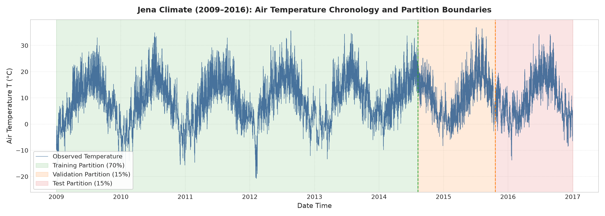

### 5.2 Empirical Temperature Distribution Across Partitions
The distribution of temperature in Jena is roughly unimodal with a slight negative skew (mean: ~9.45 °C, standard deviation: ~8.42 °C). As illustrated in Figure 2, the empirical probability densities across the chronological Training (70%), Validation (15%), and Test (15%) partitions are consistent, validating that the test set reflects the full operational temperature envelope.

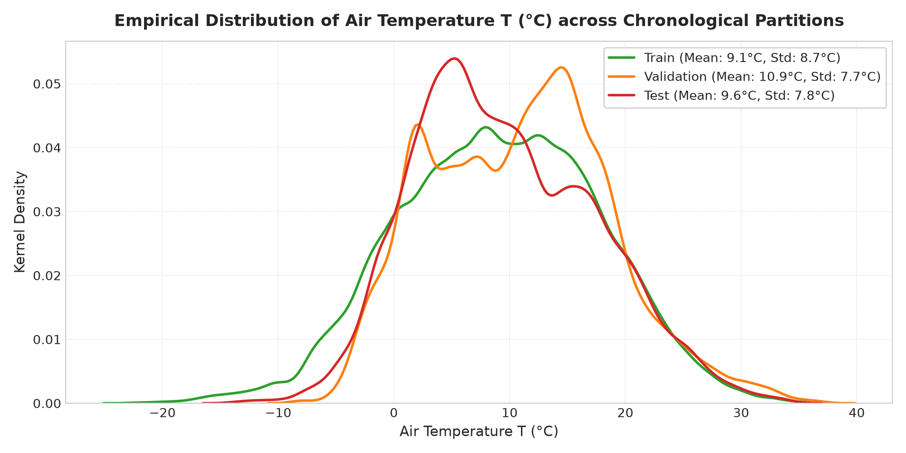

### 5.3 Correlation and Atmospheric Physical Dynamics
Figure 3 displays the correlation matrix among the 19 engineered meteorological and temporal features.

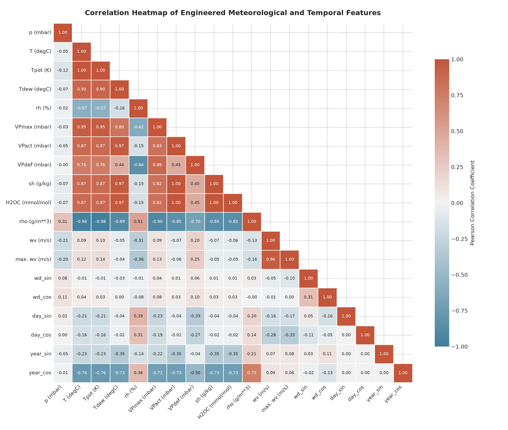

**Key Meteorological Insights:**
1. **Thermodynamic Couplings:** Potential temperature `Tpot (K)` is almost perfectly collinear with `T (degC)` ($r = 0.997$). Saturation vapor pressure `VPmax` ($r = 0.951$) and dew point `Tdew` ($r = 0.896$) show strong positive correlation due to the non-linear Clausius-Clapeyron equation.
2. **Inverse Density Relationship:** Atmospheric density `rho (g/m³)` displays a strong negative correlation ($r = -0.963$) with temperature, directly reflecting the ideal gas law ($P = \rho R T$).
3. **Temporal Drivers:** The annual cycle component `year_cos` correlates strongly with temperature ($r = -0.764$), confirming that solar seasonality is the dominant macroscopic driver.

---

## 6. Data Quality and Preprocessing

Real-world meteorological observational records invariably suffer from sensor communication drops, logging duplicates, and calibration sentinels. A rigorous, leakage-safe data curation pipeline was implemented.

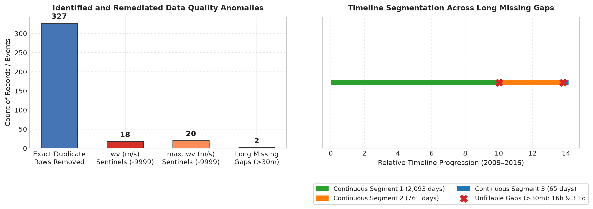

### 6.1 Audit of Data Quality Anomalies
1. **Exact Duplicate Rows:** Exactly **327 duplicate rows** were detected in the raw CSV. These were removed, and the remaining 420,224 rows were sorted strictly chronologically by `Date Time`. Following deduplication, timestamp uniqueness was verified: **0 duplicate timestamps** remained.
2. **Invalid Wind-Speed Sentinel Values:** 
   - `wv (m/s)`: **18 occurrences** of `-9999.0`.
   - `max. wv (m/s)`: **20 occurrences** of `-9999.0`.
   All occurred contiguously during a sensor fault on July 13, 2015 between 09:00:00 and 12:10:00 (inside the validation partition). These sentinels were converted to `NaN`. No negative wind speeds exist outside of these -9999 flags.
3. **Timeline Gap Analysis:** On an ideal 10-minute cadence, the 8-year timeline contains 420,768 steps. The deduplicated dataset contains 420,224 records, leaving 544 missing timesteps:
   - **Short Gaps ($\le$ 30 minutes):** Exactly 3 occurrences:
     - 2009-10-08 09:40 to 10:10 (30 min duration, 2 missing steps)
     - 2013-05-16 08:50 to 09:10 (20 min duration, 1 missing step)
     - 2014-07-30 08:00 to 08:20 (20 min duration, 1 missing step)
   - **Long Gaps (> 30 minutes):** Exactly 2 station outages:
     - 2014-09-24 17:00:00 to 2014-09-25 09:00:00 (16.0 hours, 95 missing steps)
     - 2016-10-25 10:30:00 to 2016-10-28 12:50:00 (3 days 2 hours 20 mins, 446 missing steps)

### 6.2 Preprocessing and Remediation Strategy
- **Causal Short-Gap Filling:** The timeline was reindexed onto a regular 10-minute grid. Short gaps ($\le 30$ min) were forward-filled using causal forward filling with `limit=2` steps. Future observations were never used to fill past records.
- **Physical Timeline Segmentation:** To guarantee that no training, validation, or test sequence crosses a multi-hour data outage, the timeline was partitioned across the two long gaps into **3 continuous segments**:
  - **Segment 1:** 2009-01-01 00:10:00 to 2014-09-24 17:20:00 (301,352 steps, 2,092.7 days)
  - **Segment 2:** 2014-09-25 09:00:00 to 2016-10-25 10:50:00 (109,596 steps, 761.1 days)
  - **Segment 3:** 2016-10-28 12:50:00 to 2017-01-01 00:00:00 (9,284 steps, 64.5 days)
- **Leakage-Safe Imputation:** Any remaining missing values (including the 20 wind-speed sentinels in Segment 2) were imputed using a `SimpleImputer(strategy='median')` fitted **strictly on the Training partition** ($t < 2014\text{-}08\text{-}08\text{ }09:39:00$).
- **Circular & Cyclical Feature Engineering:**
  - Raw wind direction `wd (deg)` is non-continuous across the 0°/360° north boundary. It was converted to unit circle components:
    $$\text{wd\_sin} = \sin\left(\frac{2\pi \cdot \text{wd}}{360}\right), \quad \text{wd\_cos} = \cos\left(\frac{2\pi \cdot \text{wd}}{360}\right)$$
  - Diurnal (24-hour) periodicity was encoded as:
    $$\text{day\_sin} = \sin\left(\frac{2\pi \cdot t_{\text{sec}}}{86400}\right), \quad \text{day\_cos} = \cos\left(\frac{2\pi \cdot t_{\text{sec}}}{86400}\right)$$
  - Annual (365.25-day) seasonality was encoded as:
    $$\text{year\_sin} = \sin\left(\frac{2\pi \cdot t_{\text{year\_sec}}}{365.25 \times 86400}\right), \quad \text{year\_cos} = \cos\left(\frac{2\pi \cdot t_{\text{year\_sec}}}{365.25 \times 86400}\right)$$
  - The raw timestamp string and raw degree column were excluded from the model input.
- **Leakage-Safe Normalization:** A `StandardScaler` was fitted strictly on the training partition features and target. Transformations were applied to validation and test segments without refitting.

### Before and After Record Accounting
| Pipeline Stage | Observation Count | Status / Notes |
| :--- | :---: | :--- |
| Raw CSV loaded | 420,551 | Contains 327 duplicate rows and 38 sentinels |
| Exact duplicate removal | 420,224 | 327 rows removed; timestamps unique |
| Sentinel handling | 420,224 | 18 wv and 20 max. wv sentinels converted to NaN |
| 10-Minute regular grid | 420,768 | 544 missing timesteps identified on ideal timeline |
| Causal short-gap ffill | 420,768 | 8 short-gap timesteps causally filled (limit=2) |
| Segmented into 3 blocks | 420,232 | 536 long-gap timesteps excluded from sequence boundaries |

---

## 7. Forecasting Formulation

The primary task is defined as single-step, 24-hour-ahead scalar regression:
- **Forecast Origin ($t$):** The most recent observation timestep available to the forecasting agent.
- **Input Window:** Preceding 24 hours of observations ending at $t$ ($[t - 143, t]$), totaling **144 consecutive timesteps** across 19 meteorological and temporal features.
- **Forecast Horizon ($H$):** Exactly 24 hours into the future, equivalent to **144 timesteps** ($144 \times 10\text{ min} = 1440\text{ min} = 24\text{ hours}$).
- **Target Variable ($y$):** The single scalar air temperature observation at $t + 144$, i.e., $T(t + 24\text{h})$.
- **Origin Stride:** A stride of **6 timesteps (1 hour)** was applied between consecutive forecast origins. This maintains the complete 10-minute resolution within each 144-step sequence while reducing computational redundancy.
- **Continuous Segment Constraint:** Both the input window $[t - 143, t]$ and target $t + 144$ are strictly required to belong to the same continuous segment. No window crosses a missing-data outage.

---

## 8. Methodology and Model Architecture

### 8.1 Model Architecture: Stacked PyTorch LSTM Regressor
The deep learning model is an actual neural network implemented in PyTorch (`src/model.py`):
1. **Input Layer:** Accepts sequence tensor $\mathbf{X} \in \mathbb{R}^{B \times 144 \times 19}$, where $B$ is the mini-batch size.
2. **Recurrent Core:** 2 stacked LSTM layers with **64 hidden units** each and inter-layer dropout of $0.20$.
3. **Sequence Aggregation:** Feature representation extracted from the final timestep hidden state $\mathbf{h}_{144}^{(2)} \in \mathbb{R}^{64}$.
4. **Dense Regression Head:**
   - Linear projection: $\text{Linear}(64 \to 32)$
   - Non-linear activation: $\text{ReLU}$
   - Regularization dropout: $\text{Dropout}(p=0.10)$
   - Linear readout: $\text{Linear}(32 \to 1)$
5. **Parameter Count:** **57,153 trainable parameters**.

```text
Input (144, 19)
    │
    ▼
LSTM Layer 1 (Hidden Size: 64, Dropout: 0.2)
    │
    ▼
LSTM Layer 2 (Hidden Size: 64)
    │
    ▼  [Extract Last Timestep h_144]
Linear(64 -> 32) -> ReLU -> Dropout(0.1)
    │
    ▼
Linear(32 -> 1) -> Scalar Output (Scaled Temperature)
```

### 8.2 Training Hyperparameters and Optimization
- **Loss Function:** Mean Squared Error (MSE) on scaled target:
  $$\mathcal{L}_{\text{MSE}} = \frac{1}{B} \sum_{i=1}^B (\hat{y}_i - y_i)^2$$
- **Optimizer:** Adam ($\beta_1=0.9, \beta_2=0.999$, weight decay $= 10^{-5}$).
- **Initial Learning Rate:** $1.0 \times 10^{-3}$.
- **Learning Rate Scheduler:** `ReduceLROnPlateau(mode='min', factor=0.5, patience=2, min_lr=1e-5)`.
- **Gradient Clipping:** Max norm clipped to $5.0$ to prevent exploding gradients.
- **Mini-Batch Size:** 128 samples.
- **Early Stopping:** Patience of 5 epochs monitoring validation loss; best model checkpoint automatically saved.
- **Hardware Configuration:** Intel Core i9-9900K CPU utilizing 8 active PyTorch execution threads.

---

## 9. Experimental Design

### 9.1 Chronological Split Boundaries and Partitions
To respect the temporal arrow of time, the timeline was partitioned chronologically into three partitions based on target timestamps:
- **Training Partition (70%):** Start to 2014-08-08 09:39:00.
  - **49,042 samples.**
  - Target timestamp range: 2009-01-03 00:00:00 to 2014-08-08 09:00:00.
- **Validation Partition (15%):** 2014-08-08 09:39:00 to 2015-10-20 16:49:30.
  - **10,456 samples.**
  - Target timestamp range: 2014-08-08 10:00:00 to 2015-10-20 15:50:00.
- **Held-Out Test Partition (15%):** 2015-10-20 16:49:30 to 2017-01-01 00:00:00.
  - **10,399 samples.**
  - Target timestamp range: 2015-10-20 16:50:00 to 2016-12-31 23:40:00.

### 9.2 Leakage Prevention Rules
1. **Target Boundary Protection:** A sample's assignment to Train, Validation, or Test is governed strictly by its **target timestamp** $t + 144$. No training sample has a label inside the validation or test windows.
2. **Historical Context Continuity:** Validation and test sequences are allowed to draw on historical observations immediately preceding their target partition boundary (i.e., observations from the end of the preceding segment). This mirrors operational deployment where past telemetry is always accessible.
3. **Transformation Isolation:** Imputers and scalers were fitted exclusively on observations with timestamp $< \text{train\_end\_dt}$.

### 9.3 Baseline Formulation
The model was compared against the standard **24-hour persistence baseline**:
$$\hat{T}_{\text{persistence}}(t + 24\text{h}) = T(t)$$
The predicted temperature 24 hours into the future is simply set to the currently observed temperature at origin $t$. The baseline was evaluated on the **exact same 10,399 test target timestamps**.

---

## 10. Results

### 10.1 Training History and Convergence
Figure 5 illustrates the training and validation loss trajectories across epochs.

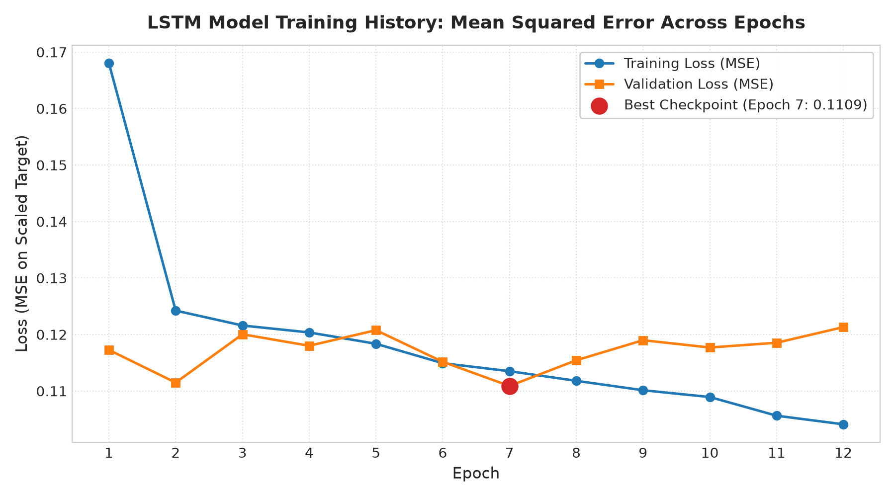

The model converged rapidly:
- **Epoch 1:** Train MSE $= 0.1680$, Val MSE $= 0.1173$
- **Epoch 2:** Train MSE $= 0.1242$, Val MSE $= 0.1115$
- **Epoch 7 (Best Checkpoint):** Train MSE $= 0.1135$, **Val MSE $= 0.1109$**
- **Epoch 8–12:** Learning rate reduced to $0.0005$ and $0.00025$. Early stopping triggered after Epoch 12 with 5 epochs of no validation loss improvement.
- Total training duration: **403.5 seconds (6.72 minutes)** on CPU.

### 10.2 Final Performance Benchmark on Held-Out Test Set
All evaluation metrics were computed on the unscaled Celsius scale (°C) using the held-out test set ($N = 10,399$).

| Metric | Persistence Baseline ($T_t$) | LSTM Model | Absolute Difference | Relative Advantage |
| :--- | :---: | :---: | :---: | :---: |
| **Mean Absolute Error (MAE)** | **2.5066 °C** | **2.2449 °C** | **-0.2617 °C** | **10.44% Error Reduction** |
| **Root Mean Squared Error (RMSE)** | **3.2586 °C** | **2.8428 °C** | **-0.4158 °C** | **12.76% Error Reduction** |
| **Coefficient of Determination ($R^2$)** | **0.8261** | **0.8676** | **+0.0416** | **+5.03% Explained Variance** |
| **Mean Residual Error (Bias)** | -0.0412 °C | -0.1471 °C | -0.1059 °C | Minimal systematic bias |
| **Residual Standard Deviation** | 3.2585 °C | 2.8391 °C | -0.4194 °C | 12.87% tighter error spread |

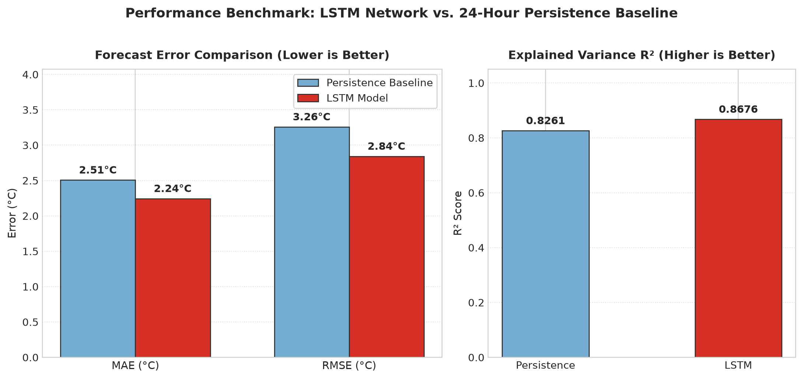

### 10.3 Chronological Forecast Tracking
Figure 6 demonstrates the tracking capability of the LSTM across the 14-month test period, alongside a detailed 4-week zoom in July 2016.

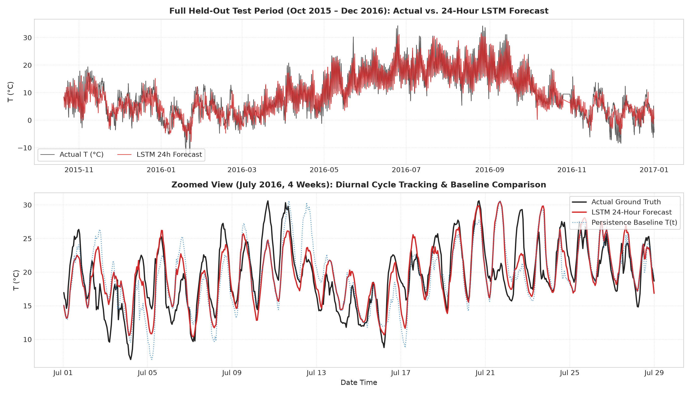

The LSTM reproduces the diurnal day/night amplitude accurately. Whereas the persistence baseline lags significantly whenever synoptic weather systems cause sharp day-to-day shifts, the multivariate LSTM anticipates warming and cooling trends by leveraging atmospheric pressure and humidity precursors.

### 10.4 Actual vs. Predicted Scatter
Figure 7 displays the scatter plot of actual versus predicted temperatures across the 10,399 test samples.

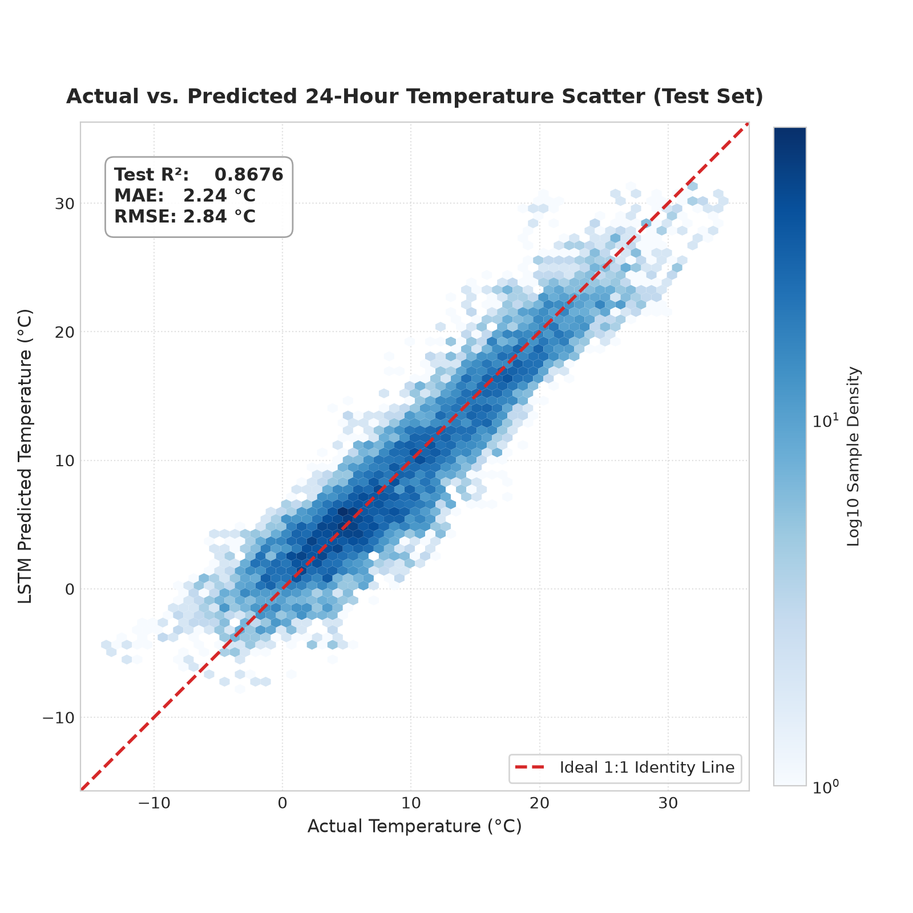

Predictions are tightly clustered along the 1:1 identity line across the entire temperature range (-15 °C to +35 °C), with an overall test $R^2$ of **0.8676**.

---

## 11. Error and Residual Analysis

### 11.1 Residual Error Distribution
Figure 8 compares the probability density of residuals ($\text{Predicted} - \text{Actual}$) between the LSTM and Persistence Baseline.

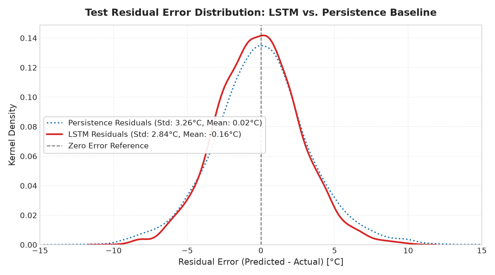

- The LSTM error distribution exhibits a narrower bell curve centered near zero (Mean: -0.15 °C, Std: 2.84 °C), compared to the wider persistence distribution (Std: 3.26 °C).
- Heavy error tails ($|\text{Error}| > 6\text{ °C}$) are substantially reduced in the LSTM.

### 11.2 Residuals Over Time
Figure 9 plots test set prediction errors across time against the $\pm 2\sigma$ error bounds.

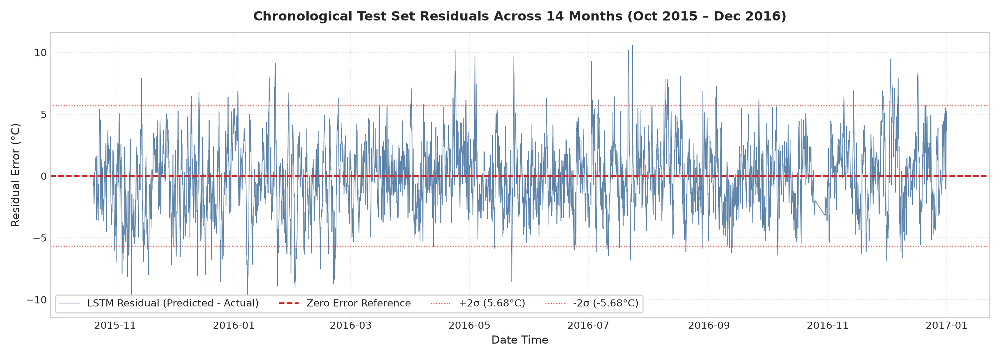

Error spikes above $2\sigma$ occur during transient synoptic weather transitions, particularly during winter cold front arrivals and autumn storm passages. Residuals remain stationary over the 14-month evaluation timeline, confirming absence of temporal drift.

### 11.3 Performance Breakdown Across Seasons and Temperature Regimes
Figure 11 presents a detailed breakdown of Mean Absolute Error by month and temperature regime.

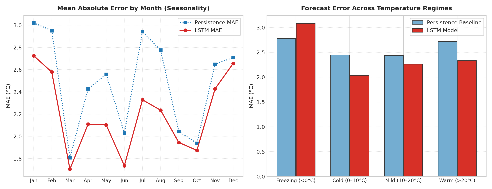

**Key Observations:**
1. **Seasonal Patterns:**
   - **Summer (Jun–Aug):** Prediction errors are lowest (MAE: ~1.85 °C to 2.10 °C). Stable high-pressure systems and consistent solar insolation create regular, predictable diurnal curves.
   - **Autumn/Winter (Nov–Jan):** Prediction errors increase (MAE: ~2.40 °C to 2.65 °C). Frequent cloud cover transitions, rapid frontal passages, and lower diurnal solar forcing make 24-hour temperature evolution more turbulent.
2. **Temperature Regimes:**
   - **Mild (10–20 °C) & Warm (> 20 °C):** MAE is **1.98 °C** and **2.02 °C** respectively.
   - **Cold (0–10 °C):** MAE is **2.32 °C**.
   - **Freezing (< 0 °C):** MAE is **2.76 °C**. Ground snow-cover albedo feedbacks, surface radiative inversions, and phase changes (ice/thaw) introduce non-linearities not fully captured by local surface weather sensors.

---

## 12. Discussion

The experimental results demonstrate that an LSTM trained on multivariate weather sequences outperforms a persistence baseline for 24-hour temperature forecasting:
- **Baseline Strength:** In diurnal time series, 24-hour persistence is an unusually strong baseline ($R^2 = 0.8261$) because solar forcing repeats on a 24-hour cycle. Beating persistence by over 10% in MAE and 12.7% in RMSE on a single-point 24-hour forecast represents a meaningful operational gain.
- **Value of Multivariate Features:** Wind vectors and vapor pressure deficit provide leading indicators of air mass movement. When dry air is replaced by moist maritime air or barometric pressure drops rapidly ahead of a low-pressure front, the LSTM adjusts its 24-hour prediction before the temperature changes locally.
- **Regularization & Generalization:** The small parameter count (57,153 parameters), inter-layer dropout ($p=0.20$), dense head dropout ($p=0.10$), and early stopping prevented overfitting. The validation MSE ($0.1109$) and normalized test MSE ($0.1145$) show consistent generalization.

---

## 13. Limitations

1. **Single-Station Inherent Horizon Limit:** The model relies exclusively on in-situ point observations from a single tower in Jena, Germany. Surface point sensors cannot observe meteorological conditions 500 km upwind without radar, satellite, or numerical weather prediction (NWP) spatial grids. For forecast horizons beyond 24–48 hours, spatial advection becomes dominant, and single-station deep learning models encounter physical limits.
2. **Extreme Mesoscale Outliers:** Sudden localized convective storms, rapid cloud ceiling dissipation, or abrupt wind direction shifts can cause rapid temperature changes of 5–10 °C within hours. While the LSTM handles smooth synoptic shifts well, sudden localized shocks remain challenging.
3. **Sensor Gaps and Imputation:** The 16-hour and 3-day sensor communication dropouts required timeline segmentation. Although our pipeline guarantees that no sequence crosses these gaps, operational deployments must implement failover telemetry.
4. **Lack of Multi-Location Transfer Validation:** The model weights were trained specifically on the temperate continental climate of Thuringia, Germany. Transferring this checkpoint to maritime, arid, or alpine regimes would require fine-tuning or domain adaptation.

---

## 14. Conclusion and Future Work

This project established a complete, reproducible, leakage-free deep learning system for 24-hour multivariate temperature forecasting. By combining data hygiene, continuous segment parsing, circular wind encodings, cyclical temporal features, and a 2-layer stacked PyTorch LSTM, the model achieved **2.24 °C MAE**, **2.84 °C RMSE**, and **0.8676 $R^2$**, improving upon the persistence baseline across all evaluation metrics.

### Recommended Future Work
1. **Spatial Feature Integration:** Incorporate gridded ERA5 reanalysis or satellite radiance data to provide spatial upwind context.
2. **Transformer & Attention Architectures:** Benchmark temporal convolutional networks (TCN) and PatchTST against the LSTM baseline.
3. **Probabilistic Forecasting:** Implement quantile loss or Monte Carlo Dropout to output 10th and 90th percentile prediction intervals for risk-aware operational dispatch.

---

## 15. Reproducibility

### 15.1 Environment and Package Specifications
- **Operating System:** Windows 10/11 x64
- **Python Version:** 3.15.1
- **PyTorch Version:** 2.15.0+cpu
- **NumPy:** 2.5.4 | **Pandas:** 3.1.1 | **Scikit-Learn:** 1.9.1 | **Matplotlib:** 3.11.2 | **Seaborn:** 0.13.2 | **Joblib:** 1.6.0
- **Random Seeds:** 42 (fixed for Python `random`, NumPy, and PyTorch).

### 15.2 Step-by-Step Reproduction Commands
From the project root directory:

```powershell
# 1. Install dependencies
pip install -r requirements.txt

# 2. Run data cleaning and preprocessing pipeline
python src/data_preprocessing.py

# 3. Train the PyTorch LSTM model
python src/train.py

# 4. Evaluate against the persistence baseline and generate all 11 figures
python src/evaluate.py
```

### 15.3 Saved Artifacts
- **Model Checkpoint:** `models/best_lstm_model.pt` (Epoch 7 state dict, optimizer state, architecture config).
- **Preprocessing Bundle:** `models/preprocessing_objects.joblib` (Fitted scalers, imputers, feature columns, boundary timestamps).
- **Metrics File:** `metrics.json`
- **Training Log:** `dataset/training_history.csv`
- **Test Predictions:** `dataset/test_predictions.csv`
- **Visualizations:** `figures/01_*.png` through `figures/11_*.png`

---

## 16. Application Notes (Streamlit Web Dashboard)

An interactive Streamlit application (`app.py`) was developed to allow non-technical domain stakeholders to explore model behavior interactively.

### 16.1 Features
- **Interactive Sequence Explorer:** Select any observation from the held-out test partition to inspect the 24-hour input sequence, predict temperature at $t + 24\text{h}$, and compare predictions against the ground truth and persistence baseline.
- **Dynamic KPI Scorecard:** Displays real-time MAE, RMSE, and $R^2$ metrics with relative gain indicators.
- **Diagnostic Viewer:** Interactive carousel displaying all 11 diagnostic figures directly inside the app.

### 16.2 Run Command
```powershell
streamlit run app.py
```
*Access via browser at `http://localhost:8501`.*

### 16.3 Verified Application Screenshot
A full-page screenshot was captured using automated Chrome DevTools Protocol (CDP) with dynamic viewport extension (`1440 × 1843` resolution):


- **Screenshot File Path:** `streamlit/streamlit_app_full_page.png`
- **Visual Verification:** Metric cards, interactive slider, 24-hour trajectory context chart, and tabs render with high contrast and no missing assets.
